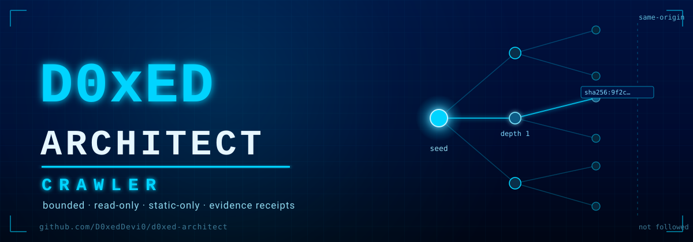
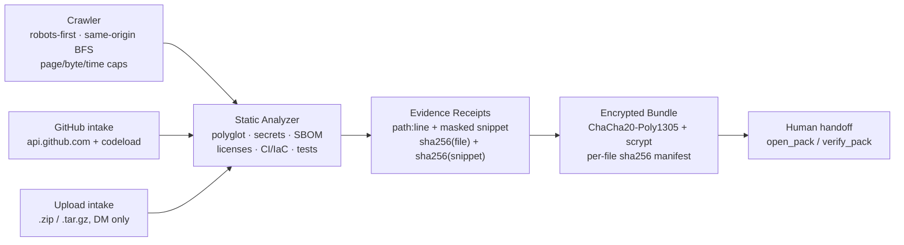

<p align="center">
  
</p>

<p align="center">
  <a href="https://github.com/D0xedDevi0/d0xed-architect/tree/main/tests"></a>
  <a href="https://www.python.org/"></a>
  <a href="LICENSE"></a>
  <a href="https://t.me/DEVinlooperbot"></a>
  <a href="https://base.org"></a>
</p>

# D0xED Architect

**A bounded, read-only code-intelligence crawler and polyglot static analyzer,
fronted by DEVin — a Telegram bot (Looper #706) that reads your code cold and
stamps every finding with a `path:line` and a `sha256` receipt.**

Send DEVin a public GitHub repo, or DM it a `.zip` / `.tar.gz` of your own
tree, and it statically maps secrets, risky patterns, import cycles, dependency
rot, and drift — then hands the result back sealed as one encrypted file.
Source is read. Source is never executed.

## Architecture



## Features

| Component | What it does |
|---|---|
| `devin/crawl2.py` | Bounded BFS crawler: depth limits, same-origin enforcement, robots.txt on every URL (fails closed if unavailable), sitemap/index discovery, link + asset inventory, per-page SHA-256 provenance receipts, XML entity rejection, page/byte/time caps. |
| `devin/analysis.py` | Polyglot static analyzer: language detection by extension/manifest, secret rules, SBOM/dependency extraction, licenses, CI/IaC/test signals, lockfiles, evidence receipts, masked snippets, traversal-safe archive extraction. |
| `devin/deep_audit.py` | Deep architecture/debug report: languages, entrypoints, top imports + import cycles, dependency manifests, CI workflows, test files, TODO/FIXME counts. |
| `devin/pack.py` + `devin/crypto.py` | Encrypted artifact packager: per-file SHA-256 manifest, embedded static audit, sealed with ChaCha20-Poly1305 (RFC 8439, pure stdlib) + scrypt key derivation, refuses on discovered live credentials, size caps, `open_pack` / `verify_pack`. |
| `devin/upload.py` | Private code-set intake: DM a `.zip` / `.tar.gz`, bounded before and after download, magic-byte validation, traversal/symlink/hardlink protection, static-only processing. |
| `devin/github_audit.py` | Public and private GitHub intake via `api.github.com` + `codeload.github.com`, with an optional PAT used **only** as an `Authorization` header. |
| `devin/deploy/` | Deployment reality: hardened systemd unit, encrypted credentials, fail-closed allowlists. |
| `devin/voice.py` | The social layer. An authored, offline voice (greeting, identity, builder talk, the nostalgia desk, refusals) plus a hard output guard, and an **optional** env-gated model for open-ended tech questions. No key → he still talks; a model answer that breaks the rules is discarded, not posted. |

## Commands

| Command | What it does |
|---|---|
| `/start` | Intro banner |
| `/help` | Command list |
| `/spellbook` | How DEVin works, in his own words |
| `/lore` | Who DEVin is (on-chain identity) |
| `/audit <github-url>` | Static scan: secrets + risky patterns |
| `/debug <github-url>` | Deep read: languages, imports, cycles, manifests, CI, tests |
| `/map <url>` | Map one page of a public site, robots first |
| `/crawl <url> [depth]` | Bounded crawl, same-origin, robots on every URL (depth 1-4, default 2) |
| `/sitemap <url>` | `sitemap.xml` / `sitemapindex` inventory |
| `/bundle <github-url>` | Seal a repo into one encrypted file (DM only) |
| `/sigil <words>` | sha256 stamp of your exact words — the same receipt every finding carries |
| `/doctor` | Self-diagnostics |
| `/link` | Deep links to add DEVin anywhere |

## Using it in a group

Add it to a room and **address it** — several bots share these rooms, so DEVin
stays silent unless it is spoken to. An allowlisted room is authorized as a
*room*: every member may use it, no per-person list required.

| How you address it | Result |
|---|---|
| `/crawl@DEVinlooperbot https://example.com` | crawls the site |
| `@DEVinlooperbot /audit https://github.com/o/r` | audits the repo |
| `@DEVinlooperbot what can you do?` | answers in his own voice (the spellbook, short form) |
| `@DEVinlooperbot I still miss my floppy drive` | answers in kind — he came up on old iron |
| reply to one of its messages | treated as addressed |
| a bare `/crawl` with no mention | never delivered to the bot at all |

Telegram's group privacy setting is the outer filter: with privacy ON (the
default) it delivers only messages that mention the bot, address a
`/command@self` to it, or reply to it. Expensive commands take a 15-second
per-person cooldown in rooms so a public room cannot be used as a free crawler;
DMs are never throttled. Private repos and sealing still need credentials and
stay DM-only for code.

Proof of the whole route — the live check transcript and the service's own
journal — is in
[`docs/group-route-evidence.md`](docs/group-route-evidence.md).

## Talking to him

Plain text works — no command needed. He answers from an authored voice that
needs no network and no API key, so the character is the same on a box with
nothing configured:

🟦 **The beats he always answers**: greetings, `gm`, thanks, *who are you*,
*what can you do*, builder talk ("I'm shipping on Base"), the refusals (price,
trades, wallets — not his desk), and the **nostalgia desk**: mention a BBS,
a 2400-baud modem, a floppy, amber phosphor, a turbo button, a soldering iron,
DOS, IRC, an Amiga, punch cards, dot matrix — he answers as someone who used
them.

🟦 **Open-ended tech questions** ("explain a rollup vs an L2") go to an
*optional* model, enabled only by `DEVIN_LLM_ENDPOINT` / `DEVIN_LLM_API_KEY` /
`DEVIN_LLM_MODEL` on an allowlisted inference host. Without it they get an
honest next step instead of an invented answer. Every model reply must pass a
hard guard — no links, no handles, no claims of having run, deployed, bought or
sent anything, no price talk, no secret requests — or it is thrown away and the
authored voice answers.

🟦 **He never gets chatty in a room**: one answer per person per 10 seconds,
the room's menu hint is budgeted per chat, and a *bot* sender cannot reach the
social layer at all (a sibling bot mentioning him is ignored, and no sibling
bot can make him spend a model call).

🟦 `/sigil <words>` stamps any words you hand over with a sha256 — the same
receipt that rides on every finding he files.

## What it looks like

The test suite is the source of truth for what works:

```console
$ cd d0xed-architect
$ python3 -m unittest $(ls tests/test_devin_*.py | sed 's|/|.|; s|\.py$||')
................................................................................................................................................................................................................................................................................................................................................
----------------------------------------------------------------------
Ran 336 tests in 7.476s

OK
```

A static pass never executes a file and never leaks a secret — findings are
masked and receipted:

```console
$ python3 - <<'PY'
from devin.analysis import analyze_tree
rep = analyze_tree("demo")
for f in rep.findings:
    print(f"{f.severity:8s} {f.path}:{f.line} [{f.rule}]")
    print(f"    {f.snippet}")
    print(f"    sha256:{f.snippet_sha256[:16]}…  (file {f.file_sha256[:16]}…)")
PY
files: 2  loc: 6  languages: {'Python': 1}
critical app.py:3 [secret:openai_key]
    API_KEY = "sk-123…cdef (35 chars)"
    sha256:1120215a4d60ecb0…  (file 96d398b2f051…) 
high     app.py:3 [secret:conn_string_pw]
    API_KEY = "sk-123…cdef (35 chars)"
    sha256:1120215a4d60ecb0…  (file 96d398b2f051…)
```

Sealing a tree refuses live credentials by default, and a clean seal round-trips:

```console
$ python3 - <<'PY'
from devin.pack import build_pack, verify_pack
try:
    build_pack("demo", "correct horse battery staple", label="demo")
except Exception as e:
    print("refused:", e)          # live credentials -> refused
open("demo/app.py", "w").write("def greet(n): return f'hi {n}'\n")
res = build_pack("demo", "correct horse battery staple", label="demo")
print(f"plaintext: {res.plaintext_bytes} B -> sealed: {res.encrypted_bytes} B")
print(f"bundle sha256: {res.bundle_sha256[:16]}…")
v = verify_pack(res.blob, "correct horse battery staple")
print(f"verified files: {v['checked']}   cipher: chacha20-poly1305 + scrypt")
PY
refused: refusing to seal: live credentials detected (2 high/critical secret finding(s)) …
plaintext: 742 B -> sealed: 808 B
bundle sha256: 63a130bcd381607e…
verified files: 2   cipher: chacha20-poly1305 + scrypt
```

## Quickstart

```console
$ cd d0xed-architect

# run the suite
$ python3 -m unittest $(ls tests/test_devin_*.py | sed 's|/|.|; s|\.py$||')

# run the bot (requires a Telegram bot token + an allowlist; see devin/deploy/)
$ DEVIN_BOT_TOKEN=... DEVIN_ALLOWED_USERS=... python3 -m devin
```

The bot is deployable as a hardened systemd unit with the token held in an
encrypted systemd credential — see [`devin/deploy/README.md`](devin/deploy/README.md).

## Scope and non-goals

Be clear about what this is and is not:

🟦 **Static, read-only.** Files are opened and read as text. Nothing is
executed, built, installed, or imported. No shell, no subprocess, no eval.

🟦 **No autonomous deployment.** A sealed bundle is a handoff artifact; a
human decides what to do with it. Nothing here publishes or ships anything.

🟦 **No signature / key-exchange / forward-secrecy claim.** The crypto is
symmetric AEAD — ChaCha20-Poly1305 + scrypt — for a passphrase holder.
Confidentiality + integrity in transit, nothing more, and it is no defense
against a weak passphrase.

🟦 **Honest language breadth, not semantics.** Language identification is by
extension and manifest. It is not semantic understanding, and it is not a
runtime/build compatibility guarantee.

🟦 **Public site crawling only.** No private-site crawling. SSRF defenses are
deliberate and host-pinned, but not a perfect guarantee.

🟦 **Bounded everywhere.** Pages, depth, per-page bytes, total bytes, wall
clock, findings, and upload size are all capped and fail closed.

## Links

🟦 [d0xeddev.com](https://d0xeddev.com)
🟦 [@D0xedDevi0 on X](https://x.com/D0xedDevi0)
🟦 [DEVin on Telegram](https://t.me/DEVinlooperbot)
🟦 [The Loopers](https://t.me/theloopers)
🟦 [GitHub](https://github.com/D0xedDevi0)

MIT License — built in the open. Read-only, always.
