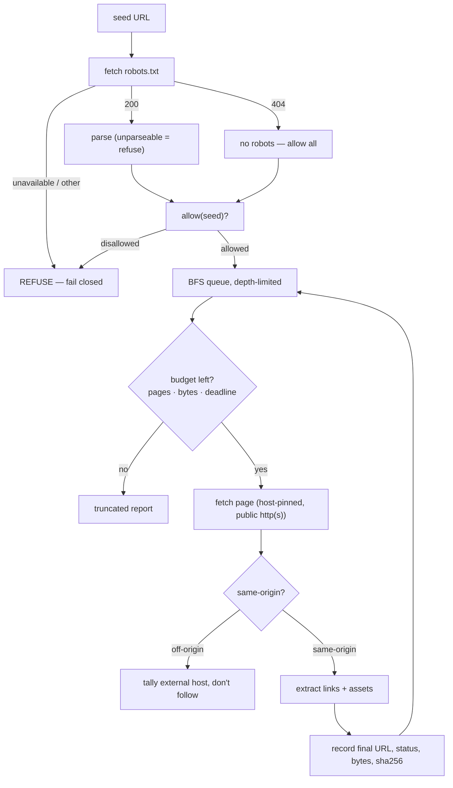
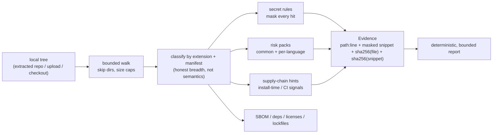
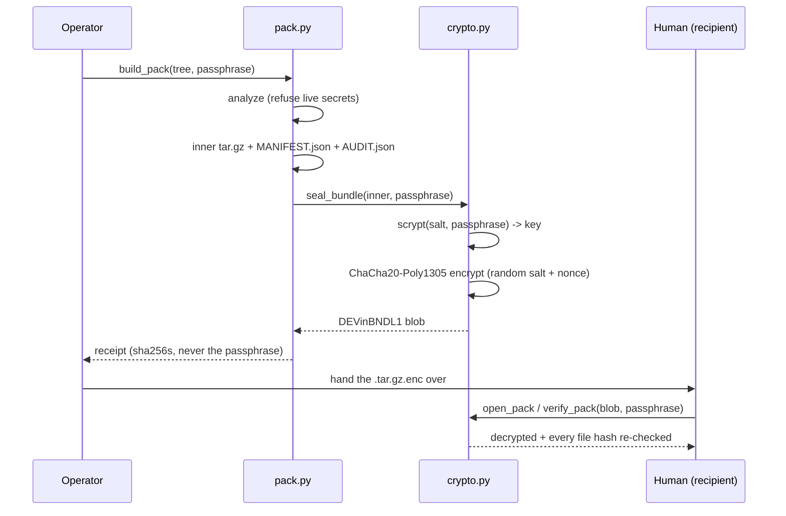

# D0xED Architect — Architecture & Safety

This is the deeper reference for how DEVin actually works. It describes
boundaries and guarantees, not marketing. If a claim here conflicts with the
code, the code wins — these files are the source of truth:

🟦 `devin/crawl2.py` — the crawler
🟦 `devin/analysis.py` — the static analyzer
🟦 `devin/deep_audit.py` — the deep audit
🟦 `devin/pack.py` + `devin/crypto.py` — the encrypted bundle
🟦 `devin/upload.py` — uploaded-archive intake
🟦 `devin/github_audit.py` — GitHub intake
🟦 `devin/deploy/` — the hardened systemd unit

## 1. Crawler semantics — bounded, same-origin, robots-aware

The crawler is a depth-limited breadth-first search over a **single origin**.
It is not a general-purpose spider.

Hard rules, enforced by construction in `crawl2.py`:

🟦 **Same-origin only.** Scheme + host + port must all match; a `www.`↔apex
hop is *not* same-origin and is never followed.

🟦 **robots.txt on every URL, fail closed.** If robots is unavailable or
unparseable the crawl refuses rather than proceeding blind. `404` means no
policy, so everything is allowed; any other status is a refusal.

🟦 **Sitemap support.** `Sitemap:` lines in robots.txt plus conventional
guesses are read; `<sitemapindex>` descends one level. Entity-bearing XML
(`<!ENTITY`, `<!DOCTYPE`) is rejected before parsing — a billion-laughs or XXE
payload is refused, not expanded.

🟦 **Hostile data, not instructions.** Page content is parsed and never
interpreted as commands, never used to build a URL outside the allowlisted
origin, and never used to authorize anything.

### Budgets (crawler)

| Limit | Default | Notes |
|---|---|---|
| `max_pages` | 12 | hard page budget |
| `max_depth` | 2 | the bot accepts `1–4` via `/crawl <url> [depth]` |
| `max_page_bytes` | 2,000,000 | per-page body cap |
| `max_total_bytes` | 8,000,000 | aggregate byte budget |
| `max_assets` | 300 | asset inventory cap |
| `max_external_hosts` | 40 | external-host tally cap |
| `max_url_len` | 2048 | per-URL length cap |
| `deadline_s` | 45.0 | wall-clock budget |
| `fetch_timeout` | 20.0 | per-fetch timeout |

## 2. Static-analysis safety model

`analysis.py` is the master engine. It walks a local tree and reads files as
text — never executes them, never makes network calls, never holds
credentials.

Guarantees:

🟦 **Nothing is executed.** `open()` + read as text only. No subprocess, no
`eval`, no imports of audited code.

🟦 **No secret ever leaves in the clear.** Secret-shaped tokens are masked in
the snippet; every finding carries a `sha256` of the file and of the snippet,
so a report can be re-verified against the tree.

🟦 **Deterministic and bounded.** Output order and content are stable, and
every ceiling (`max_files`, `max_file_bytes`, `max_total_bytes`,
`max_findings`) is a safety limit, not a preference. Never dropping a
critical finding — truncation sorts severity-first.

🟦 **Traversal-safe extraction.** `safe_member()` validates archive member
paths without rewriting them; `extract_zip` / `extract_tarball` refuse
absolute paths, `..`, backslashes, symlinks, and hardlinks, and enforce
file/byte caps so a hostile archive cannot fill the disk.

### Budgets (analysis & intake)

| Context | Limit | Notes |
|---|---|---|
| analysis `max_files` | 1,500 | files scanned per tree |
| analysis `max_file_bytes` | 300,000 | per-file cap |
| analysis `max_total_bytes` | 24,000,000 | aggregate cap |
| analysis `max_findings` | 120 | findings retained |
| GitHub audit `max_files` | 200 | `github_audit.AuditLimits` |
| GitHub audit `max_total_bytes` | 4,000,000 | metadata + tarball |
| pack `max_tarball_bytes` | 16,000,000 | refuse before download |
| upload cap | 15,000,000 | `.zip` / `.tar.gz` / `.tgz`, DM only |

## 3. Crypto design — ChaCha20-Poly1305 + scrypt (symmetric AEAD)

The bundle format is a pure-stdlib implementation of RFC 8439
ChaCha20-Poly1305 AEAD with `hashlib.scrypt` key derivation. It is verified
against the official RFC 8439 test vectors in `tests/test_devin_crypto.py`.

### Container format (`DEVinBNDL1`)

| Offset | Size | Field |
|---|---|---|
| 0 | 10 | magic `b"DEVinBNDL1"` |
| 10 | 16 | scrypt salt |
| 26 | 12 | AEAD nonce |
| 38 | 4 | scrypt `n` (big-endian) |
| 42 | 4 | scrypt `r` |
| 46 | 4 | scrypt `p` |
| 50 | … | ciphertext ‖ 16-byte Poly1305 tag |

The header is passed as AEAD associated data, so a bundle whose parameters
were edited fails to open instead of silently decrypting differently. Salt and
nonce are drawn from `os.urandom` — the same input encrypts differently every
time.

### What the crypto is, and is NOT

🟦 **It is** symmetric confidentiality + integrity for a passphrase holder:
one bundle, one shared secret, tamper-evident on open.

🟦 **It is NOT a signature.** There is no sender authentication — anyone who
holds the passphrase can also create a valid bundle.

🟦 **It is NOT key exchange.** The passphrase is shared out of band; there is
no negotiation and no ephemeral key.

🟦 **It is NOT forward-secret.** One passphrase, one symmetric key, forever.
Compromise of the passphrase retroactively opens every bundle sealed under it.

🟦 **It is NOT a security guarantee against a weak passphrase.** Use a long
random passphrase; a weak one is weak regardless of the cipher.

🟦 **Secrets are refused, not laundered.** Encrypting a leaked credential and
mailing it somewhere is still a leak, so `build_pack` refuses a tree holding
live credentials by default. `allow_secrets=True` is an explicit, logged,
human decision.

## 4. Threat model

The design assumes everything fetched is hostile, and a human holds the
passphrase. Defenses below are deliberate but not absolute.

| Threat | Mitigation | Honest limit |
|---|---|---|
| Malicious / hostile page content | parsed as data, never executed or interpreted as instructions | parsing bugs are still bugs |
| XXE / billion-laughs in sitemaps | `<!ENTITY` / `<!DOCTYPE` rejected before XML parse, size caps | regex fallback is best-effort |
| Archive traversal / symlink / hardlink | `safe_member` path validation, non-regular members refused | relies on correct stdlib extraction |
| Unbounded memory/disk from intake | caps on declared and actual size, files, bytes, per-file | a lying `file_size` is re-checked on read |
| SSRF to internal hosts | public-IP-only, host-pinned transport; token host-gated | not a perfect SSRF guarantee |
| Token exfiltration | PAT sent only as `Authorization` header to `api.github.com` / `codeload.github.com`, never logged or echoed | a compromised process can still read it |
| Secret leakage in reports | masked snippets + `sha256` receipts | secret *detection* is regex, not semantic |
| Wrong bot / wrong chat | identity pinned (`getMe`), fail-closed allowlists, DM-only for code | configured allowlist must be correct |
| Passphrase compromise | never written to disk, never logged, never in a receipt | human is the weakest link |
| Weak passphrase brute-force | scrypt `n=2^15`, `r=8`, `p=1`; hostile bundle scrypt cost is capped on open | nothing saves a bad passphrase |

Two more boundaries worth stating plainly:

🟦 **A sealed bundle is a handoff artifact.** Nothing here runs, builds,
installs, publishes, or deploys anything, and no artifact is posted anywhere.
A human decides what happens to the file.

🟦 **Breadth ≠ understanding.** The language inventory is honest
identification by extension and manifest. It is not semantic comprehension,
and it is not a claim of runtime or build compatibility across languages.

## 5. Deployment posture

See [`devin/deploy/README.md`](deploy/README.md) for the full picture. The
short version: an unprivileged `looper-devin` user, the bot token as an
encrypted systemd credential (`LoadCredentialEncrypted`), `ProtectSystem=strict`,
`NoNewPrivileges`, an empty `CapabilityBoundingSet`, restricted address
families, and memory/task caps. Each optional capability — a GitHub PAT for
private repos, a bundle passphrase for sealing — fails closed until its
credential is explicitly provisioned.
